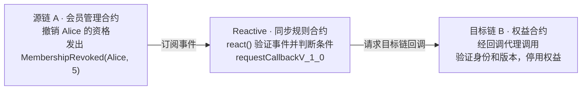

# Reactive Network Omni 学习笔记｜第 1 天

> 日期：2026-11-17

## 1.今日完成内容
- 新建测试钱包，领测试币，建立github学习仓库
- 参加开营仪式
- 阅读Reactive Contracts 概览章节

## 2.什么是Reactive Network
Reactive Network 是一种基于反应型合约构建的 EVM 自动化层，其中的事件驱动型智能合约能够实现跨链和链上自动化操作。该系统采用 CometBFT 共识机制，能够实现即时的最终结果，区块生成时间约为 1 秒，同时仍保持与 EVM 的完全兼容性。

## 3.解决问题
普通合约只有在被调用时才运行。一笔交易发出的事件只是日志，不会自己唤醒另一个合约；到了预定时间，也得有人发交易。Reactive 解决的就是谁来发现触发条件，谁来发下一笔交易。

在 Omni 里，流程是：
源链事件或 Cron → Reactive 系统调用 react() → Solidity 判断是否行动 → 目标链执

react() 用 onlySystem 限制调用来源。它可以直接更新 Reactive 链上的状态；如果要在目标链执行操作，就用 requestCallbackV_1_0 请求回调，由目标链的回调代理调用你的合约。Cron 则按区块间隔提供触发信号，适合周期任务。

## 4.应用场景

### 跨链支付联动
A 链的付款合约发出带订单号的支付事件 → B 链开通会员、发放凭证或更新订单状态

### Defi 条件单
预言机发布价格更新 → 检查是否达到止损或止盈阈值 → 请求执行，执行时再校验有效期和滑点

### 定期结算
收到 Cron 事件 → 检查是否进入新的结算周期 → 分发奖励或推进结算

### 跨链业务状态同步
A 链的授权合约发出撤销事件 → B 链停用对应权益

## 5.场景分析

以跨链业务状态同步为例：**会员资格在源链 A 管理，会员权益在目标链 B 使用。A 链撤销资格后，B 链自动停用对应权益。**

这里的 A、B 是部署时选定、且 Reactive 支持监听及回调的链；下面的合约名和事件是示例设计。

### 1.监听哪条链、哪个合约的什么事件？

监听 **A 链的会员管理合约 `MembershipRegistry`**，订阅：

```solidity
event MembershipRevoked(
    address indexed member,
    uint256 version
);
```

例如撤销 Alice 的资格后，合约发出 `MembershipRevoked(Alice, 5)`。`version` 表示该会员状态的版本号，每次变更递增，便于目标链识别过期更新。

Reactive 通过链 ID、合约地址和事件签名精确订阅这类日志。匹配后，系统调用带 `onlySystem` 的 `react()`。[Reactive Contracts](https://dev.reactive.network/reactive-contracts)

### 2.满足什么条件时触发？

分两步判断：

- **事件匹配：** 日志来自指定 A 链、指定会员管理合约，事件类型是 `MembershipRevoked`。
- **业务条件成立：** 该会员属于要同步的业务范围，事件数据有效，就请求同步撤销。

如果业务仅要求“撤销即同步”，无需再加余额、价格等阈值。**“收到可信来源的撤销事件”本身就是触发条件。**

### 3.在哪条链做什么动作？

在 **B 链的权益合约 `MembershipAccess`** 执行：

```solidity
syncRevocation(address reactiveSender, address member, uint256 version)
```

该函数先验证调用来自指定回调代理和授权的 Reactive 合约，再检查版本号。只有收到的版本高于本地版本时，才更新：

```text
active[member] = false
lastVersion[member] = version
```

这样，重复或较旧的通知不会覆盖新状态。回调认证使用 `onlyServiceProvider` 和 `onlyCallbackSender` 两个检查。[Callback Contracts](https://dev.reactive.network/callback-contracts)



这里是**异步同步**：A 链撤销成功到 B 链停用之间存在时间窗口。若会员以后可以恢复，恢复事件也要纳入同一套版本号同步，否则只同步撤销无法保持完整状态一致。

### 4.不用 Reactive 怎么做？简单在哪里，代价是什么？

| 方案 | 你需要负责什么 |
|---|---|
| 自己跑机器人 | 连接 A 链 RPC、监听和补扫日志、保存处理进度，再用有权限的钱包签名发送 B 链交易；维护私钥、余额、重试和服务可用性 |
| 手动同步 | 管理员确认 A 链撤销记录后，在 B 链发送停用交易；适合低频操作，但同步速度依赖人工 |
| 使用 Reactive | 编写订阅和判断规则，部署 B 链回调合约；网络负责事件触发和目标链交易提交 |

**Reactive 省掉的是这条自动化流程中，自建持续在线监听器和目标链发交易机器人的工作。** 规则放在 Solidity 合约里，通过订阅、`react()` 和回调串起来。[Reactive Contracts](https://dev.reactive.network/reactive-contracts) · [Callback Contracts](https://dev.reactive.network/callback-contracts)

代价主要有三项：

- **执行费用：** Reactive 合约承担自身执行费用，B 链回调合约承担目标链原生币费用；失败执行也可能收费，欠费会阻止对应侧继续执行。[Economy](https://dev.reactive.network/economy)
- **新增网络依赖：** 同步依赖 Reactive 的事件处理与回调交付。
- **业务可靠性仍要设计：** 身份验证、版本控制、失败监控和补偿机制仍由应用负责；请求回调不等于目标链状态已经更新。
