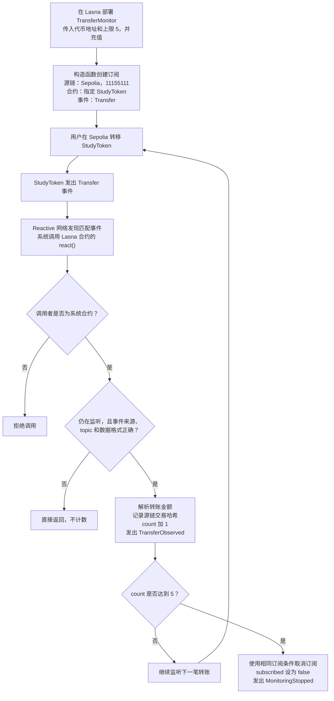

# Reactive Network Omni 学习笔记｜第 3 天

> 日期：2026-11-18

## 1.今日完成内容

- 阅读 Reactive Contracts 和 Omni 分支的 `Xfers.sol` 示例。
- 使用自部署的 Sepolia 测试代币，限定监听范围。
- 在 Lasna 部署监控合约，构造函数中订阅并充值。
- 转账触发至少一次 `react()`，理解计数上限、自动退订和欠费检查。

## 2.监控合约具体做什么

**监听 Sepolia 上指定 StudyToken 的转账，把处理结果记录在 Lasna；累计处理 5 次后自动停止监听。**

| 合约 | 部署网络 | 作用 |
|---|---|---|
| [StudyToken](../src/my-impl/transfer-monitor/StudyToken.sol) | Ethereum Sepolia，11155111 | 测试 ERC-20，部署者获得 100 万枚代币，精度为 18 |
| [TransferMonitor](../src/my-impl/transfer-monitor/TransferMonitor.sol) | Reactive Lasna，5318007 | 订阅转账、计数、记录源链交易哈希并自动退订 |

### 订阅过滤条件

订阅 Ethereum Sepolia 上指定测试代币的 `Transfer(address,address,uint256)` 事件，固定链 ID、代币地址和 topic0，topic1、topic2、topic3 使用 `REACTIVE_IGNORE`，不限制转出方、转入方，也没有金额门槛；累计处理 5 次后自动取消订阅。

```solidity
SYSTEM.subscribe(
    ORIGIN_CHAIN_ID, token_, TRANSFER_TOPIC,
    REACTIVE_IGNORE, REACTIVE_IGNORE, REACTIVE_IGNORE
);
```

### 每次 react() 的处理逻辑

- `onlySystem` 验证调用者必须是系统合约。
- 检查仍在监听且未达到上限，再检查链 ID、代币地址、事件签名、`opCode == 3` 和数据长度。
- 标准 ERC-20 Transfer 的 topic1 是转出方，topic2 是转入方，`data` 中是金额；`opCode == 3` 表示有三个 topic。
- 解析金额，更新 `lastOriginTxHash`，将 `count` 加 1，发出 `TransferObserved` 日志。
- 达到 `maxCount` 后，用与订阅完全相同的六个参数调用 `SYSTEM.unsubscribe()`，将 `subscribed` 设为 `false`，发出 `MonitoringStopped`。

状态只保存最新源链交易哈希和累计次数；每笔处理的转出方、转入方、金额及源链交易哈希保存在事件日志中。

## 3.整个过程的流程图



## 4.环境配置

真实配置保存在本地 `.env`，`.env.example` 只作为模板。已有 `.env` 时不要重新复制覆盖，也不要提交私钥或包含私钥的文件。

本实验复用 `DESTINATION_RPC` 连接 Sepolia 源链，变量名不决定链的角色；`REACTIVE_RPC` 连接 Lasna。

```bash
set -a
source .env
set +a

cast chain-id --rpc-url "$DESTINATION_RPC"
# 11155111
cast chain-id --rpc-url "$REACTIVE_RPC"
# 5318007
```

## 5.部署与触发步骤

以下命令为复现实验的方法。已部署时直接加载保存的地址进行查询，不必重复部署。

### 1.编译并在 Sepolia 部署测试代币

```bash
forge build

forge create \
  src/my-impl/transfer-monitor/StudyToken.sol:StudyToken \
  --rpc-url "$DESTINATION_RPC" \
  --account "$DESTINATION_ACCOUNT" \
  --broadcast
```

将输出中 `Deployed to` 的地址保存为 `.env` 的 `TRANSFER_TOKEN_ADDR`，重新加载配置后继续。

### 2.在 Lasna 部署监控合约并充值

本次实际部署上限为 5。部署前配置 `TRANSFER_MAX_COUNT=5`，`TRANSFER_FUNDING_WEI=100000000000000000`（0.1 个 Lasna 原生币）。

```bash
forge create \
  src/my-impl/transfer-monitor/TransferMonitor.sol:TransferMonitor \
  --rpc-url "$REACTIVE_RPC" \
  --account "$REACTIVE_ACCOUNT" \
  --broadcast \
  --value "$TRANSFER_FUNDING_WEI" \
  --constructor-args "$TRANSFER_TOKEN_ADDR" "$TRANSFER_MAX_COUNT"
```

构造函数为 `payable`，要求充值金额大于零，并在部署时完成订阅。将部署地址保存为 `.env` 的 `TRANSFER_MONITOR_ADDR`，重新加载配置。

### 3.在 Sepolia 转账

确认监控合约部署成功后，发送 1 枚 STUDY。不要依赖监控订阅之前的历史铸币事件。

```bash
cast send "$TRANSFER_TOKEN_ADDR" \
  "transfer(address,uint256)(bool)" \
  0x000000000000000000000000000000000000bEEF \
  1000000000000000000 \
  --rpc-url "$DESTINATION_RPC" \
  --account "$DESTINATION_ACCOUNT"
```

交易成功后等待网络异步处理。此时不需要用户直接调用 `react()`，它由 Reactive 系统调用。

## 6.验证结果与排查

```bash
cast call "$TRANSFER_MONITOR_ADDR" "count()(uint256)" \
  --rpc-url "$REACTIVE_RPC"
cast call "$TRANSFER_MONITOR_ADDR" "maxCount()(uint256)" \
  --rpc-url "$REACTIVE_RPC"
cast call "$TRANSFER_MONITOR_ADDR" "subscribed()(bool)" \
  --rpc-url "$REACTIVE_RPC"
cast call 0x8888888888888888888888888888888888888888 \
  "debt(address)(uint256)" "$TRANSFER_MONITOR_ADDR" \
  --rpc-url "$REACTIVE_RPC"
```

本次查询结果为：

| 项目 | 结果 | 含义 |
|---|---|---|
| `count` | 1 | 已成功处理一次转账 |
| `maxCount` | 5 | 实际部署上限为 5 次 |
| `subscribed` | true | 尚未达到上限，继续监听 |
| `debt` | 0 | 没有欠费 |

因此 `subscribed=true` 是正常状态。再处理 4 笔有效转账后，预期 `count=5`、`subscribed=false`；继续转账应不再增加计数。本次尚未记录达到上限后的实测结果。

**`maxCount` 是不可变构造参数，修改 `.env` 不会改变已部署合约的上限。** 如果计数始终为零，应核对网络、代币地址、转账时序和欠费。欠费时可调用系统合约的 `depositTo(监控合约地址)` 充值清债，随后发起新的转账验证，不假定历史事件会自动补发。

## 7.合约地址和交易证据

本次监控合约地址（用户提供）：

```text
0x9378708bf31C3175f4f2FcF608B7fbeE0aFDdA77
```

打开 [Lasna Reactscan](https://lasna.reactscan.net/)，在搜索框粘贴地址，进入详情页后复制地址栏链接作为合约证据。再查找 Sepolia 转账之后产生的成功 Reactive 交易，确认日志包含 `TransferObserved`。

```bash
cast call "$TRANSFER_MONITOR_ADDR" "lastOriginTxHash()" \
  --rpc-url "$REACTIVE_RPC"
```

上述返回的是 **Sepolia 源链转账哈希**，不能作为 Lasna 上调用 `react()` 的交易哈希。提交证据时应区分源链转账、监控合约部署和 Reactive 执行三种交易。

## 8.参考资料

- [Reactive Contracts](https://dev.reactive.network/reactive-contracts)
- [Omni micro-demos：Xfers.sol](https://github.com/Reactive-Network/reactive-smart-contract-demos/blob/omni/src/micro-demos/Xfers.sol)
- [Economy & System Interactions](https://dev.reactive.network/economy)
