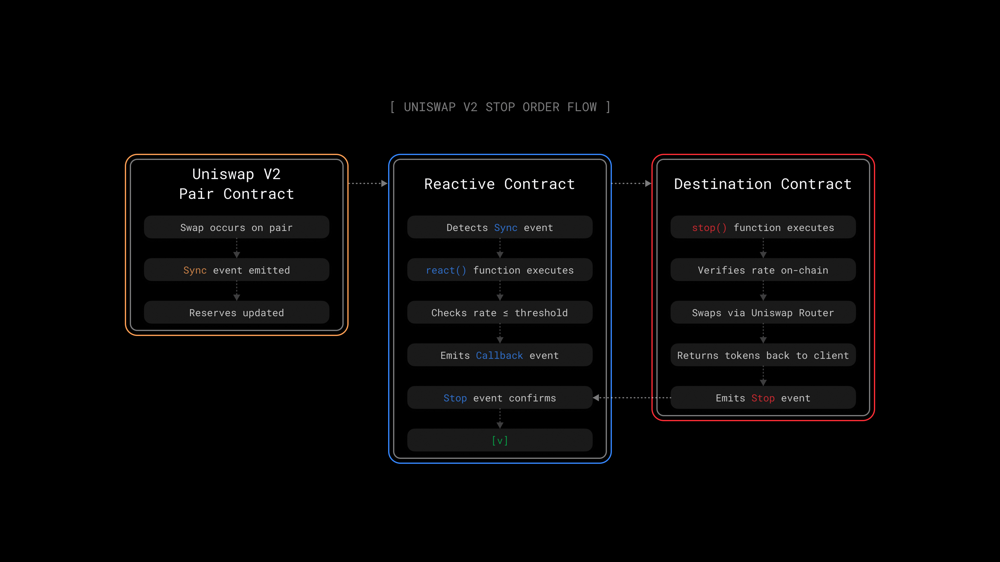

# Uniswap V2 单笔止损（Omni）

部署脚本、`.env.example` 配置和分阶段运行命令见[项目根目录说明](../../../README.md)。

Pair 的 `Sync(uint112,uint112)` → Reactive 检查储备价格 →
`SYSTEM.requestCallbackV_1_0` → Callback 重新检查价格并通过 Router 换币 →
`Stop` 事件返回 Reactive，标记完成并退订。

Callback 的执行入口同时检查 proxy 调用者和首个参数中的 Reactive 地址。



> 流程图来自原始 demo；接口和部署顺序以本说明及当前源码为准。

## Omni 环境与依赖

本目录已迁移到 Omni。依赖保留在 `lib/reactive-lib`，但来源为
`Reactive-Network/reactive-lib-omni`，固定提交：
`3ade0dcf1d27e67e5783ef807e73a1b9e0c0cce8`。
这是官方 demo 的 Omni 分支 `d1d854b4d8ded359d73dcd85cda882ec5c9aab49`
所引用的 Omni 专用库提交。

从项目根目录执行：

```bash
git submodule update --init --recursive
forge build
forge test -vv
```

部署前配置：

- `REACTIVE_RPC`：Omni Reactive 网络 RPC。
- `DESTINATION_RPC`、`DESTINATION_CHAIN_ID`：Uniswap 所在链的 RPC 和真实链 ID。
- `DESTINATION_CALLBACK_PROXY_ADDR`：该目标环境对应的 Omni callback proxy。
- `ROUTER_ADDR`、`PAIR_ADDR`：目标链的 Router 与已有流动性的 Pair。
- `CLIENT_WALLET`：持有测试代币的钱包。
- `REACTIVE_ACCOUNT`、`DESTINATION_ACCOUNT`：已经导入 Foundry keystore 的签名账户名称。

链 ID、RPC、proxy 与 Uniswap 地址必须对应同一套网络环境；不直接复用历史 README 的地址。
测试代币仍可使用单笔止损目录的 `UniswapDemoToken.sol`。

## Omni 部署与验证

以下命令在项目根目录运行；每次部署后将输出地址设置为对应变量。
先部署 Reactive，再部署 Callback，最后绑定；绑定前不建立业务订阅。
Callback 的 proxy 和 Reactive 授权地址均不可修改，Reactive 端也只允许绑定一次。

```bash
# 1. Reactive：chainId, pair, client, sellToken0, coefficient, threshold
forge create --broadcast --rpc-url "$REACTIVE_RPC" --account "$REACTIVE_ACCOUNT" \
  src/demos/uniswap-v2-stop-order/UniswapDemoStopOrderReactive.sol:UniswapDemoStopOrderReactive \
  --constructor-args "$DESTINATION_CHAIN_ID" "$PAIR_ADDR" "$CLIENT_WALLET" true 10000 8000

# 保存部署地址为 REACTIVE_ADDR。
# 2. Callback：proxy, reactive, router
forge create --broadcast --rpc-url "$DESTINATION_RPC" --account "$DESTINATION_ACCOUNT" \
  src/demos/uniswap-v2-stop-order/UniswapDemoStopOrderCallback.sol:UniswapDemoStopOrderCallback \
  --constructor-args "$DESTINATION_CALLBACK_PROXY_ADDR" "$REACTIVE_ADDR" "$ROUTER_ADDR"

# 保存部署地址为 CALLBACK_ADDR。
# 3. 由 Reactive 部署者绑定 Callback，建立 Pair Sync 和 Callback Stop 订阅。
cast send "$REACTIVE_ADDR" 'setCallback(address)' "$CALLBACK_ADDR" \
  --rpc-url "$REACTIVE_RPC" --account "$REACTIVE_ACCOUNT"
```

两侧均须在触发前充值，可在部署时使用 payable 构造函数的 `--value`，
或通过各自服务提供方的 `depositTo(address)` 充值储备。
Reactive 侧支付 REACT，Callback 侧支付目标链原生币。

确认绑定、充值及订阅成功后，再给 Callback 授权卖出代币。
此 demo 的卖出数量等于执行时的 allowance，请使用小额确定额度。

当两种代币均为 18 位精度时，`true, 10000, 8000` 表示卖出 token0，
在 `floor(reserve1 * 10000 / reserve0) <= 8000` 时触发。
从 10:10 储备开始，通过 Router 卖出约 2 token0 可使价格降到约 0.695。
用少量卖出授权验证 Swap、Stop、Done 和两条退订；完成后重复 Sync 不再请求回调。

## 保留的 demo 限制

- 单次请求后不会自动重试；失败时需排查并重新部署此单笔订单。
- Router 的 `amountOutMin` 仍为 0，且沿用原固定 deadline；本次只迁移 Omni 接口与鉴权。
- 储备比值是现货触发信号，成交数量还受手续费、滑点和回调延迟影响。

参考：[Reactive Contracts](https://dev.reactive.network/reactive-contracts)、
[Callback Contracts](https://dev.reactive.network/callback-contracts)、
[Economy](https://dev.reactive.network/economy)、
[Omni micro-demos](https://github.com/Reactive-Network/reactive-smart-contract-demos/tree/omni/src/micro-demos)。
