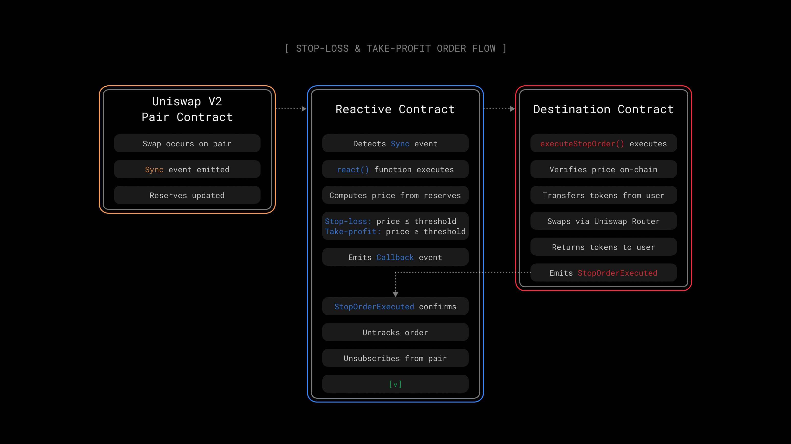

# Uniswap V2 多订单止损／止盈（Omni）

部署脚本、`.env.example` 配置和分阶段运行命令见[项目根目录说明](../../../README.md)。

用户在个人 Callback 中创建订单；Reactive 监听创建、取消、执行、暂停和恢复事件。
收到建单事件后，直接调用 `SYSTEM.subscribe` 监听 Pair 的 Sync，
达到价格条件时通过 `requestCallbackV_1_0` 请求目标链执行。
Callback 以 `onlyServiceProvider` 和 `onlyCallbackSender` 同时鉴权，并在成交前重新验证价格。
最后一笔未结束订单完成或取消后，Reactive 直接退订 Pair。
暂停订单仍占用交易对的跟踪计数，以便恢复后继续接收 Sync。



> 流程图来自原始 demo；Omni 动态订阅无需自回调，以当前源码为准。

## Omni 环境与依赖

本目录已迁移到 Omni。依赖保留在 `lib/reactive-lib`，但来源为
`Reactive-Network/reactive-lib-omni`，固定提交：
`3ade0dcf1d27e67e5783ef807e73a1b9e0c0cce8`。
这是官方 demo 的 Omni 分支 `d1d854b4d8ded359d73dcd85cda882ec5c9aab49`
所引用的 Omni 专用库提交。

从项目根目录执行：

```bash
git submodule update --init --recursive
forge build
forge test -vv
```

部署前配置：

- `REACTIVE_RPC`：Omni Reactive 网络 RPC。
- `DESTINATION_RPC`、`DESTINATION_CHAIN_ID`：Uniswap 所在链的 RPC 和真实链 ID。
- `DESTINATION_CALLBACK_PROXY_ADDR`：该目标环境对应的 Omni callback proxy。
- `ROUTER_ADDR`、`PAIR_ADDR`：目标链的 Router 与已有流动性的 Pair。
- `CLIENT_WALLET`：持有测试代币的钱包。
- `REACTIVE_ACCOUNT`、`DESTINATION_ACCOUNT`：已经导入 Foundry keystore 的签名账户名称。

链 ID、RPC、proxy 与 Uniswap 地址必须对应同一套网络环境；不直接复用历史 README 的地址。
测试代币仍可使用单笔止损目录的 `UniswapDemoToken.sol`。

## Omni 部署与验证

以下命令在项目根目录运行；每次部署后将输出地址设置为对应变量。
先部署 Reactive，再部署 Callback，最后绑定；绑定前不建立业务订阅。
Callback 的 proxy 和 Reactive 授权地址均不可修改，Reactive 端也只允许绑定一次。

```bash
# 1. Reactive：owner, destinationChainId
forge create --broadcast --rpc-url "$REACTIVE_RPC" --account "$REACTIVE_ACCOUNT" \
  src/demos/uniswap-v2-stop-take-profit-order/UniswapDemoStopTakeProfitReactive.sol:UniswapDemoStopTakeProfitReactive \
  --constructor-args "$CLIENT_WALLET" "$DESTINATION_CHAIN_ID"

# 保存部署地址为 REACTIVE_ADDR。
# 2. Callback：owner, proxy, reactive, router
forge create --broadcast --rpc-url "$DESTINATION_RPC" --account "$DESTINATION_ACCOUNT" \
  src/demos/uniswap-v2-stop-take-profit-order/UniswapDemoStopTakeProfitCallback.sol:UniswapDemoStopTakeProfitCallback \
  --constructor-args "$CLIENT_WALLET" "$DESTINATION_CALLBACK_PROXY_ADDR" "$REACTIVE_ADDR" "$ROUTER_ADDR"

# 保存部署地址为 CALLBACK_ADDR。
# 3. 由 Reactive 的 owner 绑定 Callback，建立五种订单事件订阅。
cast send "$REACTIVE_ADDR" 'setCallback(address)' "$CALLBACK_ADDR" \
  --rpc-url "$REACTIVE_RPC" --account "$REACTIVE_ACCOUNT"
```

上例假定 REACTIVE_ACCOUNT 对应 CLIENT_WALLET；若不同，绑定必须由传入的 owner 签名。
两侧均须在建单前充值，可在部署时使用 payable 构造函数的 `--value`，
或通过各自服务提供方的 `depositTo(address)` 充值储备。
Reactive 侧支付 REACT，Callback 侧支付目标链原生币。

由 Callback owner 给合约授权卖出代币后建单：

```bash
# token0/token1 均为 18 位精度：卖出 0.1 token0，价格 <= 0.8 时止损。
cast send "$CALLBACK_ADDR" 'createStopOrder(address,bool,uint256,uint256,uint256,uint8)' \
  "$PAIR_ADDR" true 100000000000000000 10000 8000 0 \
  --rpc-url "$DESTINATION_RPC" --account "$DESTINATION_ACCOUNT"

# 价格 >= 1.2 时止盈；这是另一笔独立订单，并非与止损互斥的 OCO。
cast send "$CALLBACK_ADDR" 'createStopOrder(address,bool,uint256,uint256,uint256,uint8)' \
  "$PAIR_ADDR" true 100000000000000000 10000 12000 1 \
  --rpc-url "$DESTINATION_RPC" --account "$DESTINATION_ACCOUNT"
```

DESTINATION_ACCOUNT 必须对应 Callback owner。
先等 OrderTracked 和 PairSubscribed，再通过 Router 改变池价。
从独立的 10:10 储备开始：卖出约 2 token0 可测试止损，卖出约 2 token1 可测试止盈。
观察 Callback 的 StopOrderExecuted 以及 Reactive 的 OrderUntracked/PairUnsubscribed。
还应分别验证 pauseStopOrder、resumeStopOrder 和 cancelStopOrder。

## 保留的 demo 限制

- 冷却结束需下一次 Sync 才会再次检查，无自动定时重试。
- Callback 失败后 revert 会回滚其 retryCount/Failed 更新；本次未重设计失败持久化。
- 原逻辑仍允许按余额和授权缩量成交，且使用 amountOutMin = 0。
- 多订单共享钱包资金和 allowance；没有锁仓，也没有止损止盈互相取消机制。
- 每个 Sync 遍历历史订单，测试时应限制订单数量。

参考：[Reactive Contracts](https://dev.reactive.network/reactive-contracts)、
[Callback Contracts](https://dev.reactive.network/callback-contracts)、
[Economy](https://dev.reactive.network/economy)、
[Omni micro-demos](https://github.com/Reactive-Network/reactive-smart-contract-demos/tree/omni/src/micro-demos)。
